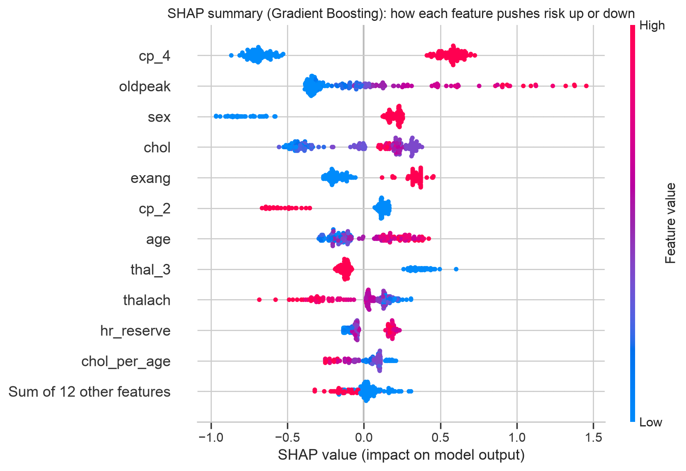

# XAI Clinic: Explainable Heart-Disease Detection

An end-to-end, audited ML project: data cleaning across four hospitals, leak-free modelling, honest
validation, explainability (SHAP), decision analysis and an interactive demo.

## Why this project is different

| Question a reviewer asks           | What this repo does                                                                 |
| ---------------------------------- | ----------------------------------------------------------------------------------- |
| Is the model comparison fair?      | Nested repeated CV + corrected paired tests (`figures/paired_tests.csv`)            |
| Are the numbers stable?            | 95% bootstrap CIs on the held-out set                                               |
| Does it work at a new hospital?    | Leave-one-hospital-out with re-tuning, with vs without missing-flags                |
| Are the probabilities trustworthy? | Calibration curves, Brier score, local-recalibration demo                           |
| Is it fair across groups?          | Sex / age / hospital / sparse-record subgroup audit                                 |
| Do the explanations hold up?       | SHAP for 3 models, grouped by clinical variable, rank agreement                     |
| What would it cost in practice?    | Operating points, cost-optimal threshold, decision curve, impact per 1,000 patients |
| Is the code reliable?              | Unit tests + GitHub Actions CI, fixed seed, `environment.txt`, locked dependencies  |
| Can I try it?                      | `uv run streamlit run app.py`                                                       |

## Key results

Model comparison (nested CV AUC): LR 0.882 ± 0.020, RF 0.880 ± 0.021, GB 0.885 ± 0.022; no pairwise difference is significant (corrected p 0.39–0.81).

Held-out test (n=184, 95% bootstrap CI): GB AUC 0.880 [0.829, 0.926]; sensitivity 0.833 [0.764, 0.906]; specificity 0.732 [0.635, 0.824]; Brier 0.140 (no-skill 0.247).

Leave-one-hospital-out AUC (GB, no flags): Cleveland 0.84, Hungarian 0.85, VA 0.71; Switzerland excluded (7% minority class). Missing-flags add +0.024 AUC on average (9/9 cells).

Decision analysis (assumed 5:1 cost, 10% prevalence): cost-optimal threshold 0.70 gives expected cost 240 vs 325 per 1,000 patients (−26%); 157 flagged, 70 of 100 cases caught, PPV 0.44.

Subgroups: AUC female 0.86 / male 0.86; age 60+ 0.81; VA 0.72 (not driven by sparse records).
Ablation: two engineered features gave no gain (0.878 → 0.877); missing-flags add +0.014 in pooled CV.

## Project layout

    xai_clinic/
      config.py            constants and run settings
      data_loading.py      find / download / parse the four UCI files
      data_processing.py   de-duplication, missingness, feature engineering, split, pipeline
      modeling.py          ablation, nested CV, tuning, bootstrap CIs, hospital-transfer, recalibration
      decision.py          thresholds, operating points, net benefit, risk tiers
      explain.py           SHAP and cross-model agreement
      reporting.py         figures, model card, summary
      run_models.py        entry point that runs everything (CLI: xai-clinic)
    app.py                 Streamlit demo (the UI)
    notebooks/walkthrough.ipynb   results notebook (reads outputs only; no logic)
    tests/                 unit tests (pytest), run in CI
    figures/               plots, tables, MODEL_CARD.md, model_artifact.joblib
    data/                  the four UCI Heart Disease files
    pyproject.toml, uv.lock, .python-version

## Run it

Install [uv](https://docs.astral.sh/uv/) once; it also fetches the right Python for you.

    uv sync                              # creates .venv from uv.lock
    uv run xai-clinic --quick            # 2-3 min smoke test (rough numbers)
    uv run xai-clinic                    # full run, ~15-30 min
    uv run streamlit run app.py          # interactive demo
    uv run pytest -q                     # unit tests

Business assumptions are command-line options, no code edits needed:

    uv run xai-clinic --cost-ratio 10 --prevalence 0.05 --model "Logistic Regression"

## Data source

Janosi, A., Steinbrunn, W., Pfisterer, M., Detrano, R. (1988). _Heart Disease_. UCI Machine Learning
Repository. https://doi.org/10.24432/C52P4X (CC BY 4.0).

## Limitations

1980s data, 4 hospitals, mostly male; labels are angiographic disease at testing (referral bias);
SHAP explains the model, not causes; cost ratio and deployment prevalence are stated assumptions;
not a medical device.

figures/model_artifact.joblib must be loaded with the same scikit-learn version; run uv sync to match, or regenerate it with uv run xai-clinic.

## License

MIT (code). See LICENSE.
